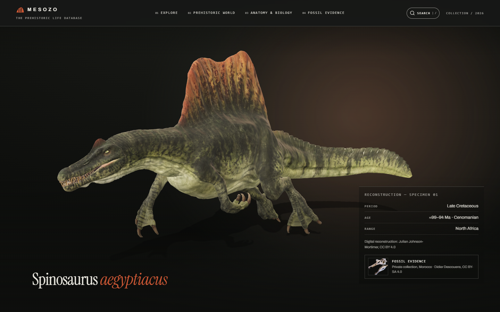
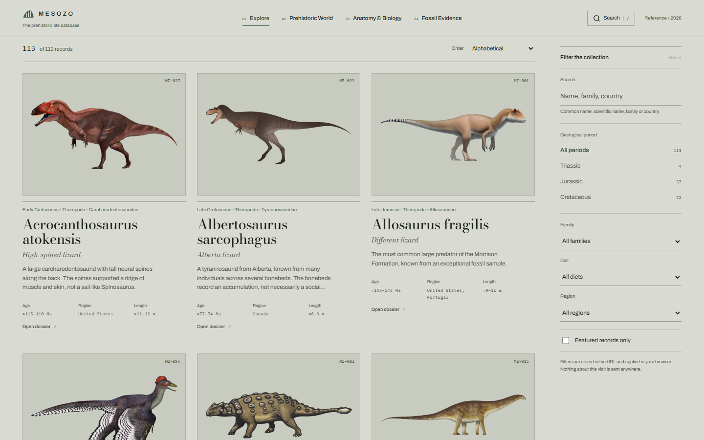
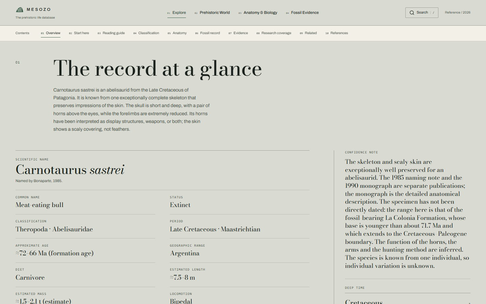

# MESOZO

MESOZO is an independent digital encyclopedia of non-avian dinosaurs, bringing species dossiers, classification, deep time, anatomy, fossil evidence and a journal into one browsable archive.

## Visuals

**Spinosaurus — full body**

**Species archive**

**Carnotaurus dossier**

